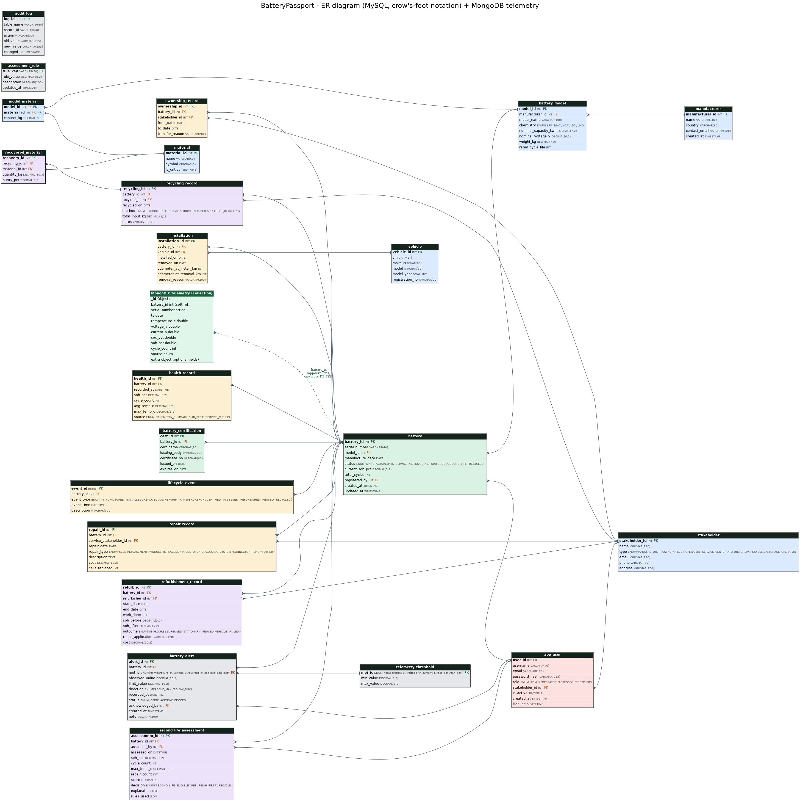
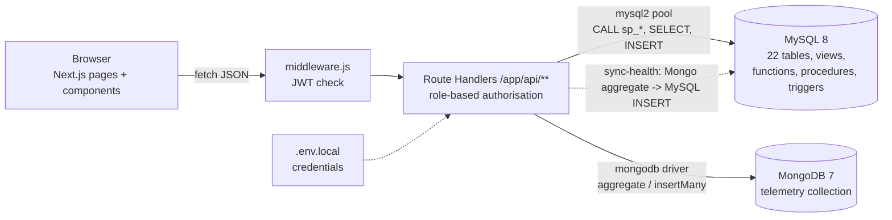

# BatteryPassport – Project Documentation
**EV Battery Lifecycle, Traceability and Second-Life Assessment Platform**
DBMS Experiential Learning – Level 3 Project

| | |
|---|---|
| Team members | *(Name 1, SRN)* – *(Name 2, SRN)* |
| Section / Instructor | *(fill in)* |
| Stack | MySQL 8 · MongoDB 7 · Next.js 14 (API routes) · Git/GitHub |

> Screenshots (section 10) and the team contribution table (section 14) must be filled in by the team after running the app.

---
## 1. Objectives
1. Maintain a digital **passport** for every EV battery (serial, model, manufacturer, chemistry, capacity, manufacture date, certifications).
2. Provide **traceability**: installation/removal, ownership transfers, repairs, certifications, assessments, refurbishment and recycling recorded in a chronological timeline that is generated by database triggers (not by the UI), so it cannot be skipped.
3. **Monitor health**: store high-volume telemetry (temperature, voltage, current, SOC, SOH, cycle count), show trends, flag configurable threshold violations.
4. Support **second-life decisions** with a transparent, configurable, rule-based assessment that stores the decision *and* its explanation.
5. Record **refurbishment, reuse and recycling**, including recovered materials, and report recovery quantities.
6. Demonstrate **database concepts** end-to-end: ER design, normalisation, constraints, triggers, procedures, transactions, views, indexing, full-text search, window functions/CTEs and NoSQL aggregation – tied to a working web app.

## 2. Functional requirements
| ID | Requirement | Where implemented |
|---|---|---|
| FR1 | Register battery (+ initial owner + certificate) atomically | `POST /api/batteries` (transaction), `/batteries/new` |
| FR2 | Install / remove battery in vehicle; one active battery per vehicle and one vehicle per battery | `sp_install_battery`, `sp_remove_battery`, trigger `trg_installation_bi` |
| FR3 | Ownership chain with automatic close of previous owner | `sp_transfer_ownership` |
| FR4 | Repairs, certifications | `repair_record`, `battery_certification`, forms on passport |
| FR5 | Chronological lifecycle timeline | `lifecycle_event` filled by 10 triggers |
| FR6 | Store telemetry, time-range + bucket aggregation | MongoDB `telemetry`, `lib/telemetry.js` |
| FR7 | Threshold violation alerts (limits configurable) | `telemetry_threshold`, `battery_alert`, ingestion + scan |
| FR8 | Telemetry summary → health record → battery SOH/cycles | `POST .../actions {sync-health}` + `trg_health_ai` |
| FR9 | Rule-based second-life assessment with saved explanation | `sp_assess_second_life`, `assessment_rule` |
| FR10 | Refurbishment & reuse outcomes | `refurbishment_record`, triggers `trg_refurb_*` |
| FR11 | Recycling with recovered materials, weight sanity check | `sp_record_recycling`, `trg_recovered_bi` |
| FR12 | Search & filter, full-text search | `/batteries`, `/search` (MATCH … AGAINST) |
| FR13 | Dashboards & analytic reports | `/`, `/reports` |
| FR14 | Authentication + 4 roles with backend authorisation | `app_user`, JWT cookie, `middleware.js`, `route(roles, …)` |
| FR15 | Admin: users, rules, thresholds, audit log | `/admin`, `trg_rule_au` |

## 3. ER diagram


Files: `ER_diagram.png`, `ER_diagram.svg` (zoomable), `ER_diagram.mmd` (Mermaid – renders on GitHub), `ER_diagram.dot` (Graphviz source).

**Entities (22 tables)** – master: MANUFACTURER, BATTERY_MODEL, STAKEHOLDER, VEHICLE, MATERIAL, MODEL_MATERIAL · core: BATTERY, BATTERY_CERTIFICATION · lifecycle: INSTALLATION, OWNERSHIP_RECORD, REPAIR_RECORD, HEALTH_RECORD, LIFECYCLE_EVENT · end of life: SECOND_LIFE_ASSESSMENT, REFURBISHMENT_RECORD, RECYCLING_RECORD, RECOVERED_MATERIAL · config/audit: ASSESSMENT_RULE, TELEMETRY_THRESHOLD, BATTERY_ALERT, AUDIT_LOG · access: APP_USER.

**Key relationships (cardinality)**
* MANUFACTURER 1 — N BATTERY_MODEL 1 — N BATTERY
* BATTERY_MODEL M — N MATERIAL (resolved by MODEL_MATERIAL, composite PK)
* BATTERY 1 — N INSTALLATION N — 1 VEHICLE (a battery/vehicle pair over time; at most one *open* row per battery and per vehicle – enforced by trigger)
* BATTERY 1 — N OWNERSHIP_RECORD N — 1 STAKEHOLDER (at most one open row per battery – enforced by the transfer procedure)
* BATTERY 1 — N REPAIR_RECORD / HEALTH_RECORD / BATTERY_CERTIFICATION / SECOND_LIFE_ASSESSMENT / REFURBISHMENT_RECORD / BATTERY_ALERT / LIFECYCLE_EVENT
* BATTERY 1 — 0..1 RECYCLING_RECORD (UNIQUE `battery_id`) 1 — N RECOVERED_MATERIAL N — 1 MATERIAL
* APP_USER 1 — N SECOND_LIFE_ASSESSMENT (assessor) ; STAKEHOLDER 0..1 — N APP_USER
* MongoDB `telemetry` N — 1 BATTERY via `battery_id` (application-level reference; a foreign key cannot span two databases)

## 4. Relational schema
See [`relational_schema.md`](relational_schema.md) (PKs, FKs, uniqueness, nullability, referential actions). The schema is in **3NF/BCNF**:
no repeating groups; non-key attributes depend only on the key (owner/vehicle/manufacturer details are never copied into lifecycle tables – only referenced);
M:N relations are resolved with associative tables; derived values that are cached (`battery.current_soh_pct`, `total_cycles`) are maintained by trigger `trg_health_ai` and
can always be recomputed from `health_record` (deliberate, documented denormalisation for fast filtering).

## 5. Database choice and justification
| Data | Database | Why |
|---|---|---|
| Manufacturers, models, batteries, vehicles, stakeholders, materials | **MySQL** | Strongly structured entities; need PK/FK/UNIQUE/CHECK, joins and referential integrity |
| Installations, ownership, repairs, certifications, health summaries | **MySQL** | Related history that must stay consistent and auditable; transactions needed (e.g. close old owner + open new owner) |
| Assessments, refurbishment, recycling, recovered materials | **MySQL** | Quantities and decisions must be reliable, relational and traceable; assessment logic needs joins/aggregates over several tables |
| Users, roles, rules, thresholds, alerts, audit | **MySQL** | Configuration & security data with constraints |
| Telemetry readings | **MongoDB** | Append-only stream of timestamped documents, potentially millions of rows; flexible optional fields per chemistry (`extra.coolant_temp_c` for NMC/NCA, `extra.cell_voltage_delta_mv` for LFP); time-range + `$group`/`$dateTrunc` aggregation; can be scaled independently of the transactional store |
| Dashboard / reports | **MySQL + MongoDB** | Backend merges lifecycle data (MySQL) with telemetry summaries (MongoDB) |

*Vector database:* not used. The data is numeric/relational/time-series, not unstructured text, so embeddings/similarity search would be technology-for-its-own-sake (course item 17). FULLTEXT search is used for the text fields (repair notes, assessment explanations, refurbishment work).

*Honest note:* MySQL could also store telemetry; MongoDB is chosen because the workload is a distinct high-volume time series with variable fields, and the project demonstrates storage, validation, indexing and aggregation in MongoDB.

## 6. System architecture

* Credentials/secrets are read only from environment variables (`.env.local`, template `.env.example`).
* Authentication: scrypt password hashes in `app_user`; signed HS256 JWT in an httpOnly cookie; Edge middleware blocks unauthenticated requests; each route declares allowed roles.
* Business rules live **in the database** (CHECK, UNIQUE, FK, triggers, procedures) so they hold regardless of which client writes the data.

## 7. Database implementation
### 7.1 MySQL – `database/mysql/`
| File | Content |
|---|---|
| `01_schema.sql` | DROP/CREATE DATABASE, 22 `CREATE TABLE`, PK/FK/UNIQUE/CHECK/ENUM, 11 B-tree + 3 FULLTEXT indexes, `ALTER TABLE` (add FK, add column, add index) |
| `02_programmability.sql` | 4 functions, 5 procedures, 19 triggers, 4 views |
| `03_seed.sql` | Sample data: 5 manufacturers, 6 models, 12 batteries, 10 stakeholders, 11 vehicles, 98 health records, repairs, certificates, assessments, refurbishments, 2 recycling events (history is created through the procedures/triggers) |
| `04_queries.sql` | 18 demonstration queries |
| `05_ddl_demo_and_tests.sql` | ALTER/DROP/DML demo, SAVEPOINT/ROLLBACK demo, 14 expected-failure integrity tests |

**Advanced features (course item 7 asks ≥ 4 SQL + 1 NoSQL):**
| Feature | Where |
|---|---|
| Transactions | `sp_install_battery`, `sp_remove_battery`, `sp_transfer_ownership`, `sp_assess_second_life`, `sp_record_recycling` (START TRANSACTION / COMMIT / EXIT HANDLER ROLLBACK, `SELECT … FOR UPDATE` row locks); JS transactions for battery registration and rule updates |
| Stored procedures | the 5 above (JSON_TABLE used to insert recovered materials from a JSON array) |
| Stored functions | `fn_get_rule`, `fn_health_grade`, `fn_battery_age_months`, `fn_cycle_life_used_pct` |
| Triggers | integrity: `trg_battery_bi/bu`, `trg_installation_bi`, `trg_refurb_bi`, `trg_recycling_bi`, `trg_recovered_bi`; automation: lifecycle events, status changes, SOH sync; audit: `trg_battery_au`, `trg_rule_au` |
| Views | `v_battery_overview`, `v_latest_assessment` (ROW_NUMBER), `v_open_alerts`, `v_recycling_material_summary` |
| Indexing | composite indexes on (battery_id, recorded_at), (battery_id, removed_on) etc.; `EXPLAIN` in `04_queries.sql` |
| Full-text search | FULLTEXT on repair descriptions, assessment explanations, refurbishment notes; `MATCH … AGAINST … IN BOOLEAN MODE` |
| CTE, window functions, CASE | pipeline query (CTE+CASE), `LAG` degradation, `RANK` per chemistry, `ROW_NUMBER` view |

**Data validation at database level (item 12):** NOT NULL, ENUMs, CHECK (SOH 0–100, dates ordered, cost ≥ 0, serial format, VIN length 17 via CHAR(17), e-mail/phone patterns, refurbishment outcome requires SOH-after), UNIQUE (serial, VIN, certificate no., one recycling per battery), FKs with RESTRICT/CASCADE/SET NULL, and trigger rules (future manufacture date, recycled batteries are terminal, no double installation, recycler/refurbisher type checks, recovered ≤ input weight).

**Consistency & integrity:** every multi-step change runs in a transaction; historical records use `ON DELETE RESTRICT` so batteries with history cannot be deleted; pure derived rows (`lifecycle_event`, `health_record`, `battery_alert`) cascade.

### 7.2 MongoDB – `database/mongo/01_setup.js`, `scripts/seed-mongo.js`
* **Database / collection:** `batterypassport.telemetry`
* **Document model (one document per reading):**
  ```json
  { "battery_id": 1, "serial_number": "BP-CATL-NMC-0001", "ts": ISODate("2026-10-30T09:00:00Z"),
    "temperature_c": 31.4, "voltage_v": 362.8, "current_a": -42.1, "soc_pct": 71.5, "soh_pct": 91.4,
    "cycle_count": 1079, "source": "SIMULATED", "extra": { "coolant_temp_c": 27.9 } }
  ```
* **Validation:** `$jsonSchema` validator (required fields, numeric ranges, enum for `source`), `validationAction: error`.
* **Indexes:** `{battery_id:1, ts:-1}` (range queries per battery, newest first); **unique** `{battery_id:1, ts:1}` (no duplicate ingestion); `{temperature_c:-1}` (hot-spot scans).
* **Retrieval strategy:** `$match` on battery + time range → `$group` by `$dateTrunc` (hour/day) with `$avg/$max/$min` → `$sort`. Fleet summary uses `$group` + `$cond`. The API joins results to MySQL data in application code (soft reference `battery_id`).
* **Embeddings / vector search:** not applicable (see section 5).
* **Cross-database consistency:** MySQL is the source of truth for the battery identity; telemetry is accepted for any `battery_id` that exists in MySQL (checked by the API before ingestion). Violations found in MongoDB become `battery_alert` rows in MySQL (`INSERT IGNORE` + UNIQUE key makes the operation idempotent). `sync-health` aggregates MongoDB and writes a `health_record` in MySQL, whose trigger updates the battery summary.

## 8. Second-life assessment rules
Stored in `assessment_rule` (editable by admin), applied by `sp_assess_second_life` on the battery's SOH, cycle count, peak temperature (max over `health_record`) and repair count:

| Rule key | Default | Meaning |
|---|---|---|
| `RECYCLE_BELOW_SOH` | 50 | SOH below → **RECYCLE** |
| `MIN_SOH_SECOND_LIFE` | 70 | SOH at/above required for direct reuse |
| `MAX_CYCLES_SECOND_LIFE` | 2500 | max cycles |
| `MAX_PEAK_TEMP_C` | 60 | max peak temperature |
| `MAX_REPAIRS` | 3 | max repair events |

Decision: `SOH < RECYCLE_BELOW_SOH` → RECYCLE; else all criteria satisfied → **SECOND_LIFE_ELIGIBLE**; else **REFURBISH_FIRST**. The failed criteria are written into the explanation text, the rule values used are stored as JSON, and an indicative 0–100 score (50 % SOH, 20 % cycle headroom, 20 % thermal headroom, 10 % repair history) is saved. *This is decision support for the project, not certified safety testing.*

## 9. Important queries
See `database/mysql/04_queries.sql` (18 queries) and the live **Reports & Queries** page of the app (11 SQL + 1 MongoDB pipeline, each showing the query text). Highlights: GROUP BY/HAVING fleet health, scalar & EXISTS subqueries, CTE + CASE pipeline, `LAG` SOH degradation, `RANK` per chemistry, recovery-rate JOIN/SUM, FULLTEXT search, Mongo `$group`/`$dateTrunc`.

## 10. Application screenshots
*(Insert screenshots: login, dashboard, battery list with filters, passport overview/timeline, telemetry charts, assessment result, recycling form, reports, admin.)*

## 11. Testing
Detailed cases in [`TEST_CASES.md`](TEST_CASES.md): 14 database integrity tests (`05_ddl_demo_and_tests.sql`) and 22 application tests (auth, RBAC, transactions, aggregation, validation). *(Record the actual outcome and date in the “Result” column when you run them.)*

## 12. Course requirement mapping
See [`REQUIREMENTS_CHECKLIST.md`](REQUIREMENTS_CHECKLIST.md).

## 13. Conclusion
BatteryPassport shows a clear link between database concepts, database design, implementation and a functional web application. SQL is used where relationships, integrity and transactions matter; MongoDB where a high-volume, flexible time series matters; and the business rules (traceability, assessment, recycling mass balance) are enforced by the database itself. Possible extensions: real BMS ingestion, predictive degradation models, vector search over repair notes, MongoDB time-series collections and sharding.

## 14. Team contributions *(fill in – commits on GitHub must reflect this)*
| Member | Database work | Application work |
|---|---|---|
| Member 1 | *(e.g. ER design, schema, triggers, procedures)* | *(e.g. API routes for batteries/lifecycle)* |
| Member 2 | *(e.g. MongoDB design, queries, seed data)* | *(e.g. UI pages, telemetry, reports, auth)* |
